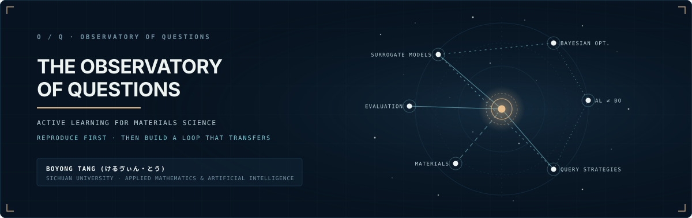

<div align="center">

<!-- B1 Deep Field Observatory Banner (Auto switches for GitHub Dark/Light modes) -->
<picture>
  <source media="(prefers-color-scheme: dark)" srcset="./assets/banner-dark.svg" />
  <source media="(prefers-color-scheme: light)" srcset="./assets/banner-light.svg" />
  
</picture>

<br />

# Boyong Tang · 唐博勇
### *ケルヴィン (Kelvin) · けるゔぃん・とう*

[](https://boyongtang.github.io)
[](https://boyongtang.github.io/about/)
[](https://boyongtang.github.io/research/)
[](mailto:boyong.tang.math.ai@gmail.com)

<p>
  <strong>Observe the unanswered.</strong><br />
  <em>Mapping questions, methods, and the evidence between them.</em><br />
  <sub>为尚未解决的问题绘制一张可追溯的研究星图。</sub>
</p>

</div>

---

### 📡 Observer Dossier / 观测者档案

```yaml
Observer: Boyong Tang (Kelvin / けるゔぃん・とう)
Affiliation: Sichuan University (SCU), Chengdu, China
Discipline: Applied Mathematics · Artificial Intelligence
Coordinate: 30°39'N, 104°04'E (UTC+08:00)
Status: OBSERVATION ACTIVE // RESEARCH IN PROGRESS
Primary Portal: https://boyongtang.github.io
```

I study applied mathematics and machine learning, with a focus on how models make reliable decisions under uncertainty, and how we can rigorously understand what they learn.

---

### 🌌 Current Research Signals / 核心研究问题

In this observatory, research is mapped as celestial nodes linked by explicit relations (*motivates*, *uses*, *evaluates*, *documents*):

| Code | Type | Inquiry / Topic | Status | Dossier Link |
| :--- | :--- | :--- | :---: | :--- |
| **`R-001`** | **Research** | **Active Learning for Formulation Discovery**<br /><sub>Efficient sample acquisition when high-performing candidates are rare.</sub> | `ONGOING` | [Read Dossier ↗](https://boyongtang.github.io/research/active-learning-formulation/) |
| **`R-002`** | **Research** | **Faithful Explanations for Learned Models**<br /><sub>Distinguishing genuine computational mechanisms from plausible post-hoc attributions.</sub> | `EXPLORING` | [Read Dossier ↗](https://boyongtang.github.io/research/faithful-explanations/) |
| **`R-003`** | **Research** | **Convergence Dynamics of First-Order Methods**<br /><sub>Analytical bounds, step-size invariants, and numerical behaviour.</sub> | `EXPLORING` | [Read Dossier ↗](https://boyongtang.github.io/research/first-order-convergence/) |
| **`Q-001`** | **Question** | **Sample-Selection Efficiency Under Uncertainty**<br /><sub>How uncertainty-aware acquisition balances exploration with costly experiments.</sub> | `OPEN` | [View Question ↗](https://boyongtang.github.io/atlas/#q-discovery) |

> 🪐 Explore the complete interactive graph on the [**Research Celestial Atlas ↗**](https://boyongtang.github.io/atlas/).

---

### 🔭 Scientific Instruments / 代码与工具

- [**`BoyongTang.github.io`**](https://github.com/BoyongTang/BoyongTang.github.io) — Source code of the personal academic observatory, built with Astro, TypeScript, SVG celestial mapping, and KaTeX math.
- [**`ML-practice`**](https://github.com/BoyongTang/ML-practice) — Foundations of machine learning from mathematical first principles (optimization, linear models, probability, and implementations).

---

### 📝 Field Notes / 观测日志

- **`[N-001]`** [**Why 1/L? Notes on the Descent Lemma**](https://boyongtang.github.io/notes/descent-lemma/) — *Deriving the fundamental inequality behind gradient descent.*
- **`[N-002]`** [**Evaluation Protocols in Active Learning**](https://boyongtang.github.io/notes/al-evaluation-protocols/) — *Where benchmark comparisons quietly fail.*
- **`[N-003]`** [**从零开始的机器学习：第一周笔记**](https://boyongtang.github.io/notes/ml-from-zero-week1/) — *从正规方程到梯度下降的数学推导与直觉。*

---

### 📨 Contact & Verification / 联系方式

- **Email:** [`boyong.tang.math.ai@gmail.com`](mailto:boyong.tang.math.ai@gmail.com)
- **Academic Home:** [https://boyongtang.github.io](https://boyongtang.github.io)
- **Publications & Preprints:** [Public Record Index ↗](https://boyongtang.github.io/publications/)
- **CV Document:** Available upon request via email.

<br />

<div align="center">
  <sub>STATION OQ-01 · CONCEPT B1 DEEP FIELD · FACT-BASED CITATIONS ONLY</sub>
</div>
