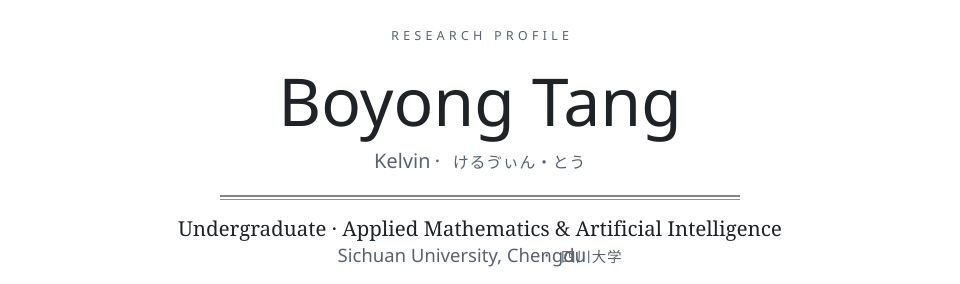

<!-- images in assets/ are drawn by scripts/build.py -->

<picture>
  <source media="(max-width: 600px) and (prefers-color-scheme: dark)" srcset="./assets/hero-dark-mobile.svg" />
  <source media="(max-width: 600px)" srcset="./assets/hero-light-mobile.svg" />
  <source media="(prefers-color-scheme: dark)" srcset="./assets/hero-dark.svg" />
  
</picture>

<a href="https://boyongtang.github.io">Homepage</a>

### About

I study applied mathematics and AI at Sichuan University. My current work is focused on AI4S.

四川大学本科生，应用数学和人工智能双学士学位，目前正在做AI4S的相关工作。

If u want to know me better, please click [link](https://boyongtang.github.io).

如果你想更好的了解我，请点击这个[链接](https://boyongtang.github.io)。

<!--
### Research interests
(to be filled in)
-->

### Publications

- **KolTa: A Physics-Informed Active Learning Framework for Formulation Discovery with Limited Data**-
[arxiv](https://arxiv.org/abs/2611.06394)

### Projects

- **[BoyongTang.github.io](https://github.com/BoyongTang/BoyongTang.github.io)** — source of the homepage: static Astro pages and a research atlas that also works as a plain list.

<picture>
  <source media="(max-width: 600px) and (prefers-color-scheme: dark)" srcset="./assets/footer-dark-mobile.svg" />
  <source media="(max-width: 600px)" srcset="./assets/footer-light-mobile.svg" />
  <source media="(prefers-color-scheme: dark)" srcset="./assets/footer-dark.svg" />
  
</picture>
